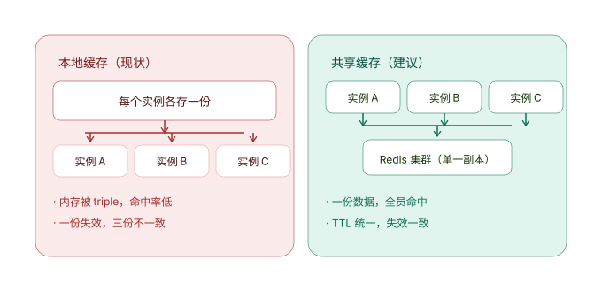
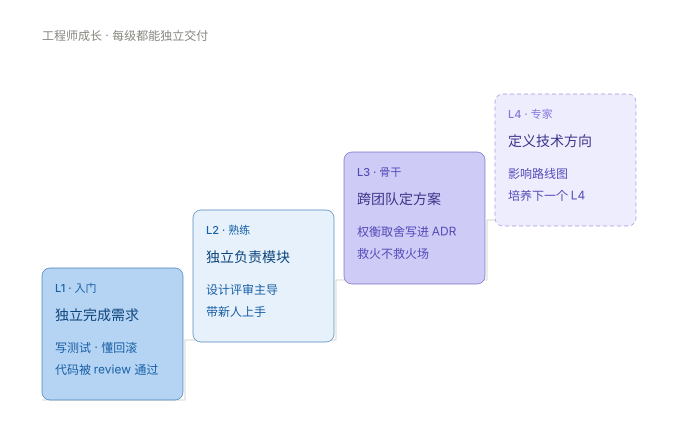
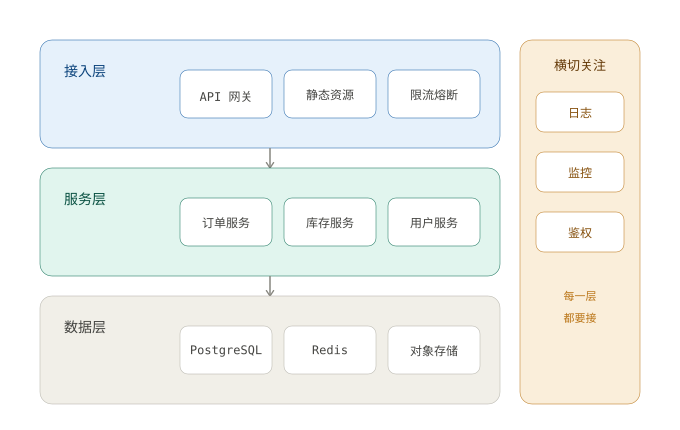
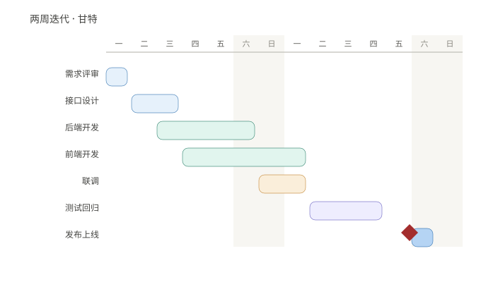

# 墨图 · MoTu

**把对话里的代码块变成真正的图。**

**墨图（MoTu）** 是 DeepSeek Harness 的可视化套件：模型在回复里写一段带语言的代码块，浏览器端就把它渲染成图。六种渲染方式全部**随插件本地伺服——不联网、不走 CDN**，使用本机随包引擎；每个引擎按需懒加载，只画流程图的会话不会下载图表库。

> 三个名字，一处对应：仓库 **`DSH-MOTU`** · 品牌 **墨图 / MoTu** · npm 包名 **`dsh-visual-kit`**（也是插件 id 与路由前缀 `/dsh-visual-kit/*`）。

> 设计取向一句话：**一张清楚的图胜过三段文字**。所以插件不只是"能渲染图"，它还会要求模型在讲解结构、流程、对比、方案时**主动配图**，并给出成图规范。

[](https://github.com/molanxuan-del/DSH-MOTU/actions/workflows/ci.yml)
[](LICENSE)


## 效果

手写 SVG 渲染器适合概念对照、时间线、路线图；仍需检查 SVG 结构、文字溢出与留白：









以上十张都是本仓库生成器（`scripts/design-showcase.mjs`）产出的，用来演示同一套设计令牌覆盖的十种版式：对比 / 时间线 / 阶梯 / 闭环 / 分层架构 / 四象限 / 漏斗 / 流程 / 卡片网格 / 甘特。

## 六种渲染方式

| 渲染器 | 栅栏 | 擅长 |
| --- | --- | --- |
| **Mermaid** | ` ```mermaid ` | 流程、时序、状态、甘特、饼图、脑图 |
| **Graphviz** | ` ```dot ` / ` ```graphviz ` | 结构关系、依赖、架构分层 |
| **nomnoml** | ` ```nomnoml ` | 小而清楚的框线图 |
| **ECharts** | ` ```echarts ` / ` ```echarts-interactive ` | 数量、占比、趋势；前者静态，后者交互（JSON 配置） |
| **Vega-Lite** | ` ```vega-lite ` / ` ```vegalite ` / ` ```vega ` | 分层、分面统计图（JSON 规格） |
| **手写 SVG** | ` ```svg ` | 概念对照、时间线、路线图、闭环、架构图 |

没有语言的代码块会按内容识别（首行是 `flowchart TD` 的 mermaid、以 `digraph` 开头的 Graphviz、以 `<svg` 开头的 SVG……）。

## 交互图表

普通 `echarts` 代码块继续输出静态 SVG。需要悬停查看数值、图例筛选或区间缩放时，使用新语言：

```echarts-interactive
{"legend":{},"tooltip":{"trigger":"axis"},"xAxis":{"type":"category","data":["周一","周二","周三"]},"yAxis":{"type":"value"},"series":[{"name":"访问量","type":"bar","data":[120,180,150]}]}
```

工具栏提供重置、复制配置、导出当前 SVG 和反馈；图例与 `dataZoom` 必须在 JSON 中声明。主题改变会重建实例，源码更新会完整替换配置。交互模式默认开启，可以在能力页或配置 `renderers.echarts.interactive` 中关闭；关闭后新语法以静态图显示并说明原因，ECharts 总开关和自动渲染总开关继续生效。

输入只接受 JSON 和内联数据，最多 **256 KiB、10,000 个数据点**。不执行配置中的函数或 HTML，提示框强制使用 `richText`；不允许图片、URL 或其他外部资源引用。交互初始化失败后仅尝试一次静态渲染；两次都失败时保留源码与错误卡片。每次初始化最多等待 15 秒，第三方库的同步计算不能被取消信号强行中断。

本轮建立展示句柄与生命周期基础，图片继续使用 DSH 原生能力，网页截图、三维与视频尚未接入。

## 放大展示

密集的图在 360px 画布里会缩到看不清。图框工具栏的「**放大**」把图铺满窗口：滚轮按**指针位置**缩放（光标下的细节留在光标下）、拖拽平移，`+` / `−` / `适应` / `1:1` 按钮，键盘 `Esc` 关闭、`0` 适应窗口、`1` 原始尺寸、方向键平移、`Tab` 焦点不逃出面板。

它展示的是**快照 SVG**（与「下载」写出的同一份字节），而不是搬动活的图表实例——原图继续在正文里渲染，矢量快照放到多大都清晰，静态图与交互图走同一条路径。关闭后焦点回到触发按钮、页面滚动恢复原状；插件卸载时遮罩层一并收掉。

## 安装

```bash
git clone https://github.com/molanxuan-del/DSH-MOTU.git
cd DSH-MOTU
npm install                                  # 安装依赖并自动执行 prepare → 生成本地引擎产物
dsh plugin --profile <name> add link:$PWD
```

`npm install` 会通过 `prepare` 脚本自动运行 `npm run vendor`：把引擎产物拷进 `vendor/`、写入哈希清单、生成技能文件。`vendor/` **不入库**（6.6 MB 第三方产物），克隆后一次 `npm install` 即可得到。

安装后在 DSH 设置里会出现本插件的配置页与「**可视化套件**」能力页，全部改动**即时生效**。

## 给模型用

插件在模型侧做了三件事：

1. **一行常驻提示**：要求模型讲解结构、流程、对比、方案或数据时**主动画一张图**（不必等用户要求），并说明各栅栏的选型与成本纪律；
2. **`dsh-visualization` 技能**：按需加载的完整参考——选型表、各引擎语法要点、手写 SVG 设计系统（配色令牌、发丝线、开放箭头、字号层级、`<title>`/`<desc>` 无障碍）；
3. **能力与宣传一致**：关掉某个渲染器后，它的栅栏恢复成普通代码，模型也不再被告知它能用。

## 设置面板

设置里的「**可视化套件**」页把能力摆在明面上：

- **总开关**：自动渲染 / 模型侧提示段 / 技能 / 反馈时让本会话直接修；
- **ECharts 交互模式开关**：保留静态语法，按需启用新语法；
- **六个渲染器各一个滑动开关**，每张卡片带**实时预览**——预览走的是对话里同一条渲染管线，所以面板不会和实际出图不一致；
- 开关写入的是**插件的真实配置行**（经宿主 `configEditor` 持久化），不是页面上的一层影子状态，因此配置页、提示段、技能、渲染目录始终同步。

## 出错时

渲染失败**不会破坏对话**：原代码块保留，下面出现一张错误卡片，写明**哪个渲染器、什么原因、怎么改**，并附该渲染器的**最小可用示例**（可折叠）。

静态错误卡片可以「**反馈并修复**」，交互图表与交互错误卡片提供「**反馈**」：

1. 把诊断写入本地日志 `~/.dsh/visual-kit/reports.jsonl`；交互反馈保留原始失败阶段和模式，源码按 UTF-8 截断为最多 16 KiB，不发送给作者；
2. 静态错误在开启自修设置时，可将请求投递给当前会话的 agent（会使用该会话模型和 token）；交互反馈仅记录和复制诊断，不自动修改插件。反馈、复制、会话投递分别显示真实结果。

## 完整性校验

`vendor/integrity.json` 记录每个引擎文件的 SHA-256、字节数与版本。三层校验：

1. **启动时**校验所有已启用渲染器的引擎文件；
2. **伺服时**每个文件首次读取再校验一次；
3. **`GET /dsh-visual-kit/health`** 随时可查逐文件结果。

`strict` 模式下校验失败的渲染器自动禁用（并在图的位置给出可读原因），而不是加载一半诡异失败。

## 路由

| 路由 | 用途 |
| --- | --- |
| `GET /dsh-visual-kit/config` | 有效配置、启用集合、提示文本、开关快照 |
| `POST /dsh-visual-kit/config` | 写入配置（字段按配置 Schema 校验，未知字段丢弃） |
| `GET /dsh-visual-kit/renderers.json` | 浏览器渲染用的渲染器目录（含示例源码，供面板预览） |
| `GET /dsh-visual-kit/assets/<id>/<file>` | 引擎产物（白名单伺服，长缓存，哈希不符返回 503） |
| `GET /dsh-visual-kit/health` | 完整性报告 |
| `GET/POST /dsh-visual-kit/diag` | 诊断信标与反馈落点 |

## 开发

```bash
npm install            # 依赖 + prepare 自动生成 vendor/
npm test               # 宿主、六适配器、展示生命周期与交互回归测试
npm run check:renderers # 无头渲染六个引擎，产出真实产物并校验
npx playwright install chromium
npm run check:ui        # 真实 Chromium：悬停/图例/区间缩放/导出/主题/取消/失败注入
node scripts/design-showcase.mjs   # 重新生成 README 里那十张设计示例
```

Chromium 夹具使用真实引擎与插件路由，结果与浅深色窄屏截图写入 `.scratch/ui-check/`。夹具不替代 DSH 宿主验收；宿主需提供 `configEditor` 才能持久化开关。本地支持基线为 DSH `0.2.0-rc.2`。

本轮已使用桌面版随附的 DSH `0.2.0-rc.2` 启动隔离宿主，验证原生设置页保存、刷新与重启后持久化、原生助手回复中的交互栅栏、跨会话切换、SVG 导出及本地反馈。测试消息通过宿主会话接口创建，没有调用付费模型。旧版 CLI `0.1.5-rc.1` 缺少设置写入服务，会显示可读错误。

部分宿主会隐藏未知语言的标签；客户端通过宿主公开的会话聊天快照恢复原始栅栏语言，并按同源码出现顺序区分静态与交互图，不依赖 React 内部字段。

### 新增一种可视化（5 步）

1. `npm i <引擎>`（devDependency）；
2. `lib/renderers/manifest.js` 加一条记录（id / languages / label / output / assets / defaults / syntaxHint / 能力标志）；
3. `lib/client.js` 的 `ADAPTERS` 里加一个适配器（`loadEngine` + `render`，30–80 行）；
4. `npm run vendor`（拷贝产物、更新哈希、重新生成技能文件）；
5. `npm test && npm run check:renderers`。

配置界面、设置面板、提示段、技能、健康检查由清单派生。新增交互模式还需声明可选 `modes` 与实际能力，并实现 `mount`：返回带 `dispose()` 的展示句柄，可选提供 `resize()`、`reset()`、`scale()`、`snapshot()`。原有 `render()` 返回 `{ markup }` 的适配器继续通过兼容包装显示。工具栏按实际句柄能力显示操作。

### 目录结构

```
lib/index.js              宿主半：配置 Schema、路由、完整性校验、提示段与技能生成
lib/client.js             客户端半：扫描管线、六个适配器、图框、设置面板
lib/renderers/manifest.js 单一事实来源：渲染器清单（配置界面/提示/技能/面板都由它派生）
scripts/vendor.mjs        拷贝引擎产物、写 integrity.json、生成 skill/
scripts/design-showcase.mjs  README 里的十张设计示例
scripts/check-ui.mjs     Playwright Chromium 行为与故障检查
scripts/ui-fixture.mjs   本机可复现的真实引擎夹具
test/                     宿主半与客户端半的单测
vendor/                   引擎产物（不入库，npm install 生成）
```

## 呈现规范

图内字体沿用宿主应用字体栈，字号 **13px**（与正文同尺度），画布居中、16px 内边距、最高 360px，随主题切换底色；自适应缩放同时受宽度与高度约束（纵向超出会直接看不到内容，因此高度下限比宽度下限更松）。渲染失败显示错误卡片，主题变化自动重渲染。交互图表用真实容器与 ResizeObserver 更新尺寸，容器零宽度时等待可见；源码、会话、主题变化或关闭开关时取消旧任务，释放实例与监听，迟到结果不回写。静态引擎仍串行执行，每次使用独立临时容器。

手写 SVG 的设计令牌（暖中性基色 + 语义色、`stroke-width="0.5"` 发丝线、`rx=8` 圆角、开放式箭头、11/12/13/14 四级字号、`<title>`+`<desc>` 无障碍）整理自 **WorkBuddy** 对话产物中实际使用的规范——本项目按同一套规范生成示例图（见 `preview/design/`）。

## 许可

本插件为 **MIT**。

各引擎许可见其包：mermaid、Graphviz-wasm（`@viz-js/viz`）、nomnoml、graphre、DOMPurify 为 MIT；ECharts 为 Apache-2.0；Vega / Vega-Lite 为 BSD-3-Clause。
