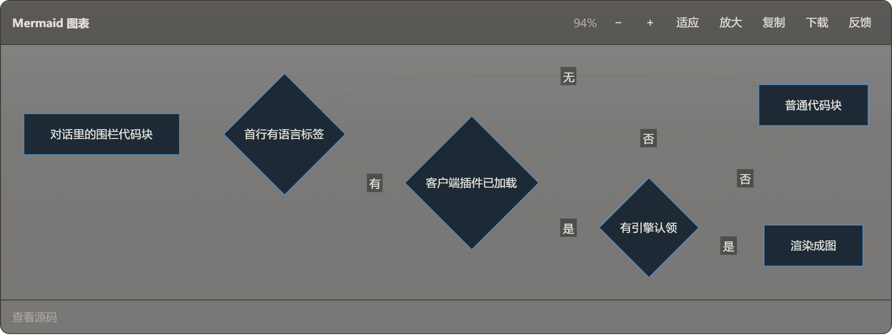
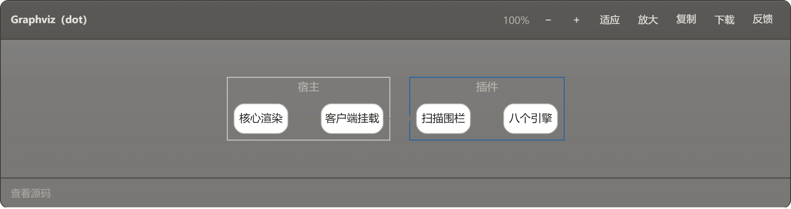
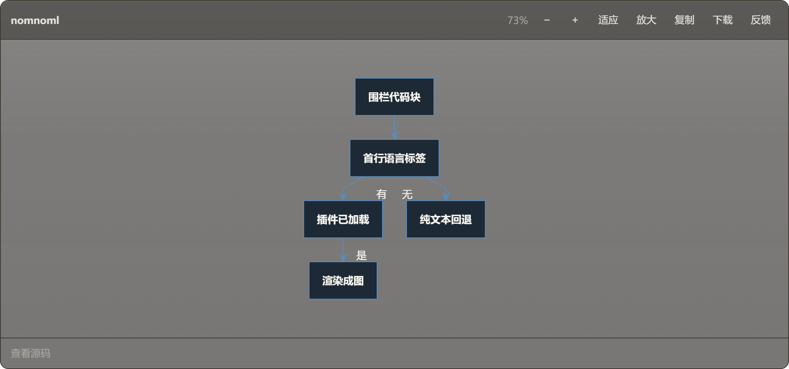
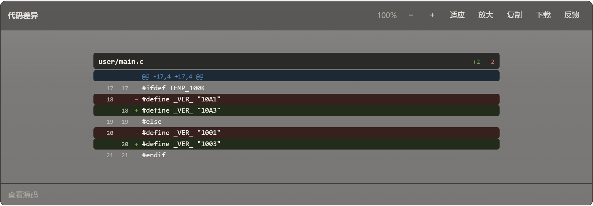
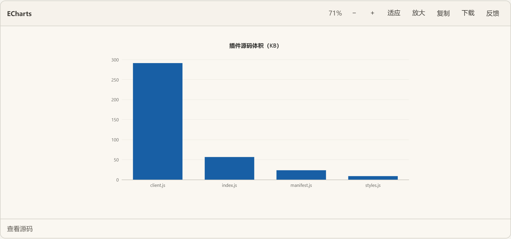

# 墨图 · MoTu（个人改动版）

把对话里的代码块渲染成图：Mermaid、Graphviz、nomnoml、ECharts、Vega-Lite、手写 SVG、等距剖面、体素模型、指标卡、用例矩阵、代码差异。引擎随包本地伺服，不联网。

**上游**：[molanxuan-del/DSH-MOTU](https://github.com/molanxuan-del/DSH-MOTU)。本仓库是 fork，功能、语法、安装与设置项以上游 README 为准；本仓库只改了下面几处。

## 改了什么

| 改动 | 说明 |
|---|---|
| 引擎配色 | Mermaid / Graphviz / nomnoml 从出厂灰改为风格语义色（蓝=主线、绿=通过、琥珀=部分），深色主题下同色向白提亮 |
| 文字对比 | 渲染后按每个文本的实际底色重算对比度，低于 4.5 的自动换成近黑或近白 |
| 图卡片材质 | 底板改为半透明磨砂，复用壁纸引擎的侧栏配方；主题插件可用 `--vk-figure-bg` 完全接管 |
| 新增 `diff` 渲染器 | `diff` / `patch` 栅栏渲染成彩色差异卡：文件头、双列行号、增绿删红（上游是单色文本） |

## 效果

深色主题下，流程图与关系图不再是灰底灰线：







新增的代码差异卡：



浅色主题（无壁纸，卡片为实底）：



> 截图取自真实渲染管线（Chromium + 随包引擎 + 插件真实 CSS），不是示意图。

## 安装

```bash
git clone https://github.com/LiTianYun/DSH-MOTU.git dsh-visual-kit
cd dsh-visual-kit
npm install                       # 依赖 + prepare 自动生成 vendor/ 与 skill/
dsh plugin --profile <name> add link:$PWD
```

`vendor/` 是第三方引擎产物（约 6.6 MB），不入库，`npm install` 时自动生成。

## 验证

```bash
npm test                 # 265 项单测
npm run check:renderers  # 12 个渲染器各产出一份真实产物并校验为合法 XML
```

## 许可

MIT。引擎许可见上游 README。
