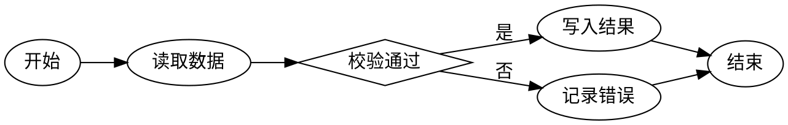

# Graphviz（dot）

流程、依赖、架构分层 —— 分层布局最稳，集群（subgraph cluster）是它的强项

- 栅栏：```dot / ```graphviz
- 引擎：@viz-js/viz@3.31.0
- 字体：该引擎只能指定**单一字体族**（CSS 字体栈无效）。中文必须显式写字体，否则标签会缺字。

## 语法

digraph G { rankdir=LR; A -> B; }；中文标签必须写 fontname="Microsoft YaHei"，分层用 subgraph cluster_x { label="…" }

## 完整示例


