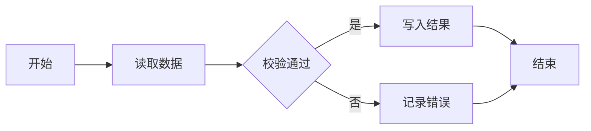

# Mermaid 图表

流程、时序、状态、类、甘特、饼图、脑图 —— 覆盖面最广，拿不准时用它

- 栅栏：```mermaid
- 引擎：mermaid@11.17.2
- 字体：字体使用宿主应用的字体栈，与正文同字号（13px），无需你处理。

## 语法

首行必须是图表类型关键字（flowchart TD / sequenceDiagram / stateDiagram-v2 / gantt / pie / mindmap）

## 完整示例


