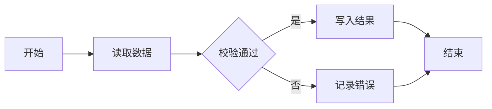

# Mermaid 图表

流程、时序、状态、类、甘特、饼图、脑图 —— 覆盖面最广，拿不准时用它

- 栅栏：```mermaid
- 引擎：mermaid@11.17.2
- 字体：字体使用宿主应用的字体栈，与正文同字号（13px），无需你处理。

## 语法

首行必须是图表类型关键字（flowchart TD / sequenceDiagram / stateDiagram-v2 / gantt / pie / mindmap）

## 易错点

- 节点文字含括号、方括号或引号时**整段加引号**：写 `A["文字（含括号）"]`，不要写 `A[文字（含括号）]`。
- 形状括号必须成对：`[]` 矩形、`()` 圆角、`[()]` 圆柱、`{}` 菱形。**只有旗形是左开口**的 `id>文字]` —— 把方括号塞进旗形（`id>["文字"]`）会直接 `Parse error`；要方框就写 `id["文字"]`。
- 子图标题写成 `subgraph 名称["标题"]`；`end` 必须单独一行。

## 完整示例


